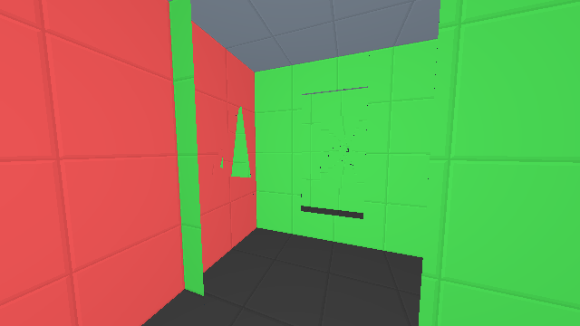

# Portal Workshop

A recursive **portal sandbox and live editor** built with Three.js. Walk through linked portals in a bright red-and-green tiled room, then press `E` to build your own: rectangle, circle, oval and triangle portal pairs that you can move, resize, rotate, copy and undo in real time. Portals are the only mechanic: no compressed-space tricks in the default mode.



## Run it

No install, server, account or network needed. Open the standalone file in a desktop browser:

```
dist/Portal Workshop.html
```

(Or `npm run build` to regenerate it from source; Node 20+.) Click the viewport to capture the mouse.

| Action | Keys |
| --- | --- |
| Move / look | `W A S D` + mouse, `Space` / `Shift` to rise / fall |
| Toggle editor | `E` |
| Add portal pair | `1` rectangle, `2` circle, `3` oval, `4` triangle |
| Select linked endpoint | `Tab` |
| Copy / cut / paste / duplicate | `Ctrl/Cmd + C / X / V / D` |
| Delete | `Delete` |
| Undo / redo | `Ctrl/Cmd + Z`, `Shift + Ctrl/Cmd + Z` or `Ctrl/Cmd + Y` |
| Renderer limits help | `?` |
| Release mouse | `Esc` |

## How it works

Rendering is ordinary Euclidean "unfolded" rasterization: every visible portal view is an extra transformed, clipped, depth-tested copy of the room in a single Three.js scene. A breadth-fair scheduler (`breadth-fair-v1`) shares a finite budget between sibling portals before recursing deeper, so no branch starves the others. Anything beyond the budget stays a closed portal surface instead of an unowned hole. The tested envelope is recursion depth 2,048 and up to 4,097 room copies; the claim is "exact within that finite envelope", not infinite recursion.

- `Portals+Compressed Space.html` is the editable source shell (UI, editor, renderer).
- `engine/` is a dependency-free engine API (scene validation and serialization, portal matrices, crossing, movement and ray traces, fair scheduling). See `engine/API.md` and `engine/SUPPORTED_ENVELOPE.md`.
- `tools/` holds the portal-screen DAG renderer and its proof tests.
- `fixtures/` has eight frozen scenes with semantic and exact pixel references.
- `scripts/build-release.mjs` inlines the engine and DAG into `dist/Portal Workshop.html` deterministically.

## Test

```sh
npm run build
npm test
npm run test:legacy
```

`npm run validate` additionally runs a headless Chromium pixel comparison of all eight scenes (needs `pip install -r requirements-validation.txt` and Chrome/Chromium).

## License

MIT, see `LICENSE`. Three.js is MIT-licensed; see `THIRD_PARTY_NOTICES.md`.
